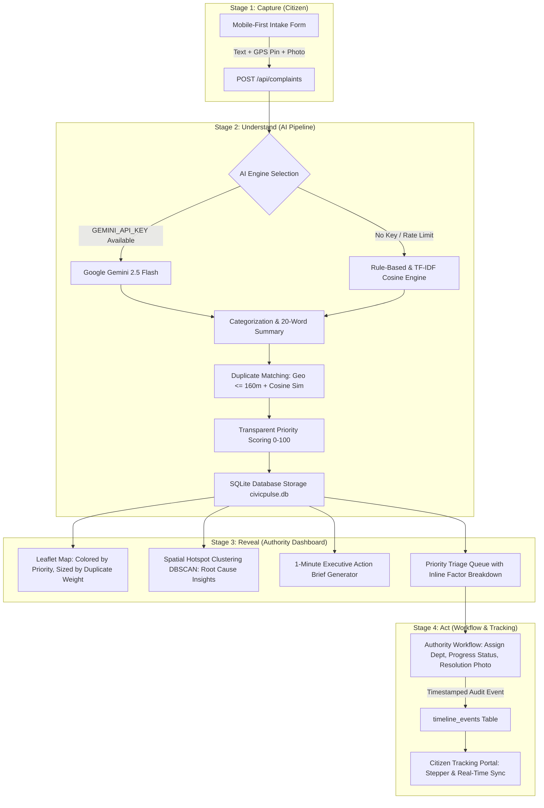

# CivicPulse AI — From Complaints to Action

> **Hackathon Theme:** AI for Civic Impact  
> **Core Premise:** Turn scattered, unstructured citizen grievances into prioritized, explainable, trackable municipal action across 4 stages: **Capture, Understand, Reveal, and Act**.

---

## 🏛️ System Architecture



---

## 🚀 Quick Start (Runs Locally in 2 Commands)

### 1. Prerequisites
- **Node.js**: v18+ (verified on Node.js v25)
- **NPM**: v9+
- Zero external database installation needed (uses embedded SQLite via WebAssembly/pure JS).
- Map runs via **OpenStreetMap** (no map API key required).

### 2. Setup & Start Backend
```bash
# In first terminal:
cd backend
npm install
node server.js
```
The backend starts on `http://localhost:5000`.

### 3. Setup & Start Frontend
```bash
# In second terminal:
cd frontend
npm install
npm run dev
```
Open **`http://localhost:5173`** in your browser. (All `/api` calls are automatically proxied to port 5000).

---

## 🔑 Environment Configuration (`backend/.env`)

The project includes `backend/.env.example` and `backend/.env`. Both Google Gemini and the built-in deterministic engine are supported:

```env
PORT=5000
GEMINI_API_KEY=your_key_here
GEMINI_MODEL=gemini-2.5-flash
```

> **Note on AI Fallback:**
> - If `GEMINI_API_KEY` is provided, CivicPulse uses the **Gemini 2.5 Flash** model for natural language categorization, summaries, and action briefs.
> - If `GEMINI_API_KEY` is empty, CivicPulse automatically engages the **deterministic rule-based keyword & TF-IDF engine**. The entire application, duplicate matching, scoring, and action briefs work 100% offline.
> - A live status badge in the navbar displays **"Gemini 2.5"** or **"Rule-Based Fallback"**.

---

## 🧠 AI Pipeline & Priority Formula

### 1. Categorization & Summarization
- **Categories:** `Waterlogging`, `Road Damage`, `Garbage`, `Streetlight`, `Drainage`, `Water Supply`, `Other`.
- **Confidence Scoring:** Computed based on semantic keyword frequency and model confidence (e.g. `94% conf`).
- **Executive Summary:** Synthesizes long citizen text into a punchy sentence under 20 words.

### 2. Duplicate Detection Engine
- **Geo-Proximity:** Haversine distance threshold set to **160 meters**.
- **Text Similarity:** Vector tokenization and cosine similarity over TF-IDF token frequencies.
- **Action:** If matched, the report is linked to the parent complaint (`parent_id = parent.id`), assigned status `DUPLICATE`, and the parent’s `duplicate_count` is incremented. **Duplicates are never deleted**; their merged weight directly boosts the parent ticket's priority.

### 3. Transparent Priority Formula (0–100 Points)
Every priority score is calculated from deterministic arithmetic rather than an unexplainable black-box:

$$\text{Total Priority Score} = \text{Safety} + \text{Category} + \text{Duplicate Weight} + \text{Sensitivity} + \text{Latency}$$

| Factor | Points Range | Deterministic Logic |
|---|---|---|
| **Public Safety Risk** | 0 – 35 pts | Open manholes (35), exposed live wires (35), deep craters causing vehicle skids (28), flooding (25), night dark hazard (20), routine maintenance (8). |
| **Category Baseline Severity** | 0 – 20 pts | Waterlogging (18), Drainage (17), Road Damage (16), Water Supply (15), Streetlight (14), Garbage (12), Other (8). |
| **Public Multiplier (Duplicates)** | 0 – 20 pts | 1 report = 4 pts, 2 reports = 11 pts, 3–4 reports = 16 pts, 5+ reports = 20 pts. |
| **Sensitive Zone Proximity** | 0 – 20 pts | Hospital emergency zone <= 300m (+20 pts), School zone <= 250m (+18 pts), Main Arterial Expressway <= 200m (+15 pts). *(Mocked facilities)* |
| **Age & Latency Escalation** | 0 – 10 pts | Escalates unresolved grievances: >24h (+5 pts), >48h (+7 pts), >72h (+10 pts). |

**Priority Bands:**
- `CRITICAL`: 75 – 100
- `HIGH`: 55 – 74
- `MEDIUM`: 35 – 54
- `LOW`: 0 – 34

---

## 🗺️ Hotspot Detection (Spatial Clustering)
- **Algorithm:** Spatial distance-based density clustering within a 260-meter radius across active complaints.
- **Root Cause Insight:** Cross-references co-located symptom categories. For example:
  - `Drainage` + `Waterlogging` $\rightarrow$ *"Likely root cause: Blocked storm drain choke-point causing road submergence and pavement degradation."*
  - `Road Damage` (3+ reports) $\rightarrow$ *"Likely root cause: Heavy commercial vehicle transit coupled with water seepage causing recurring asphalt collapse."*
  - `Garbage` + `Drainage` $\rightarrow$ *"Likely root cause: Solid waste dumping spilling into open drainage channels."*

---

## ⚡ 1-Minute Executive Action Briefs
Generated on-demand for:
1. **Single Incident Report**
2. **Geographic Hotspot Cluster**
3. **Today's Top 5 Municipal Priorities**

Each brief answers:
- **What is happening:** Concise 2-sentence situational summary.
- **Why it matters:** Concrete risk assessment and sensitive zone impact.
- **Recommended action:** Pragmatic field instruction (e.g., suction jetting, barricades, cold-mix asphalt).
- **Suggested department:** Roads, Sanitation, Electrical, Water Works, or Drainage.
- **Urgency directive:** Immediate, Urgent, or Standard Priority.
